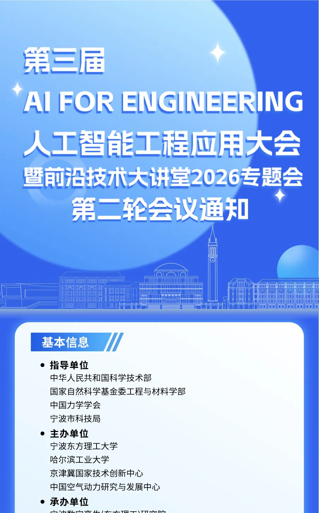

# The 3rd AI FOR ENGINEERING Conference

## AI Applications in Engineering & Frontier Technology Lecture Hall 2026 Special Session

[中文信息](README.md)

> This is an unofficial English summary prepared to help international engineering and open-source communities discover the event. Registration, payment, schedule changes, and participation requirements are governed by the [official Chinese WeChat announcement](https://mp.weixin.qq.com/s/cQ_NviW17m5fQVIpJfH-IQ).

## Event at a glance

| Item | Details |
| --- | --- |
| Dates | November 13-15, 2026; registration and check-in on November 13 |
| Venue | Eastern Institute of Technology, Ningbo |
| Address | No. 2911 Haijiang Avenue, Jiaochuan Subdistrict, Zhenhai District, Ningbo, Zhejiang, China |
| Audience | Researchers, engineers, industry experts, science and technology professionals, and graduate students working in AI, engineering science and technology, mechanics, and related fields |
| Response deadline | October 31, 2026 |
| Attendance form | [Open the AI4E attendance response form](https://qr61.cn/oUUWeT/qMDyRej) |
| Registration fee | CNY 2,000 for student delegates; CNY 3,000 for other delegates; travel and accommodation are not included |
| Official notice | [Read the original WeChat announcement](https://mp.weixin.qq.com/s/cQ_NviW17m5fQVIpJfH-IQ) |

## Scope

The conference focuses on the integration of artificial intelligence and engineering science. It brings together academia, research organizations, and industry to discuss emerging theory, enabling technologies, and engineering applications.

Highlighted areas include foundation models, physical AI, digital twins, embodied intelligence, advanced equipment, intelligent manufacturing, energy and materials, integrated circuits, quantum technologies, and cross-disciplinary engineering applications.

## Thematic tracks

1. AI foundation models
2. Embodied intelligence
3. Intelligent manufacturing, construction, operations, and maintenance
4. AI for energy and advanced materials
5. AI for fundamental sciences
6. Mechanics, aerospace, aviation, and marine engineering
7. Integrated circuits
8. Bioinformatics and interdisciplinary medical engineering

## Preliminary schedule

| Date | Time | Programme |
| --- | --- | --- |
| November 13 | All day | Registration and check-in |
| November 14 | Morning | Opening ceremony and plenary talks |
| November 14 | Afternoon | Invited parallel sessions |
| November 15 | Morning | Plenary talks |
| November 15 | Afternoon | Invited parallel sessions and closing ceremony |

## Organizers

### Guiding organizations

- Ministry of Science and Technology of the People's Republic of China
- Department of Engineering and Materials Science, National Natural Science Foundation of China
- Chinese Society of Theoretical and Applied Mechanics
- Ningbo Municipal Science and Technology Bureau

### Host organizations

- Eastern Institute of Technology, Ningbo
- Harbin Institute of Technology
- Beijing-Tianjin-Hebei National Center of Technology Innovation
- China Aerodynamics Research and Development Center

## Registration

Submit the attendance response by **October 31, 2026** through the [AI4E attendance response form](https://qr61.cn/oUUWeT/qMDyRej).

| Delegate type | Registration fee |
| --- | ---: |
| Student delegate | CNY 2,000 |
| Other delegate | CNY 3,000 |

Travel and accommodation are not included. The Chinese notice lists QR payment, bank transfer, and on-site payment. This repository intentionally does not reproduce payment QR codes or bank details. Confirm the organizer, payment recipient, and latest notice through the [official WeChat announcement](https://mp.weixin.qq.com/s/cQ_NviW17m5fQVIpJfH-IQ) before submitting personal information or making a payment.

## Source note

- Publisher: ScienceNet WeChat account
- Published: October 21, 2026, 20:06 Beijing time
- The English event title and summary on this page are unofficial translations.
- The screenshots are included only to identify and explain the publicly announced event. Copyright remains with the original publisher and respective rights holders.

